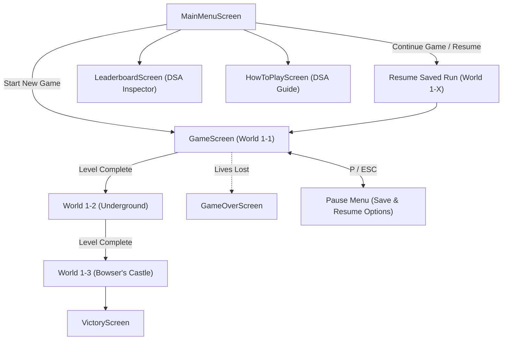

# Super Mario Run — DSA Edition
**University Data Structures & Algorithms (IT22013) Assignment**  
**Student Project** | **Language:** Java 21 | **Framework:** libGDX 1.13.1 | **Backend:** LWJGL3 | **Build System:** Gradle

---

## Table of Contents
1. [Project Overview](#1-project-overview)
2. [How to Build and Run](#2-how-to-build-and-run)
3. [Gameplay Guide & Controls](#3-gameplay-guide--controls)
   - [Keyboard Controls](#keyboard-controls)
   - [Gameplay Mechanics & Rules](#gameplay-mechanics--rules)
   - [Power-Ups & Items](#power-ups--items)
   - [The 3 Progressive Levels](#the-3-progressive-levels)
4. [Save, Resume & Player Profile System](#4-save-resume--player-profile-system)
   - [How Saving Works](#how-saving-works)
   - [How Resuming Works](#how-resuming-works)
   - [Player Profile Name Switching](#player-profile-name-switching)
   - [Save File Format](#save-file-format)
5. [Data Structures & Algorithms (DSA) Architecture](#5-data-structures--algorithms-dsa-architecture)
   - [A. Arrays](#a-arrays-fixed-world-layouts--resizable-leaderboard)
   - [B. Doubly Linked List](#b-doubly-linked-list-customlinkedlistt)
   - [C. Stack (LIFO) & Movement Undo](#c-stack-lifo--movement-undo-customstackt)
   - [D. Queue (FIFO) & Event Notifications](#d-queue-fifo--event-notifications-customqueuet)
   - [E. Sorting: Manual Bubble Sort](#e-sorting-manual-bubble-sort-bubblesortjava)
   - [F. Searching: Linear & Recursive Binary Search](#f-searching-linear-search--recursive-binary-search)
   - [G. Recursion: Countdown & Score Bonus](#g-recursion-countdown--score-bonus-recurrence)
6. [Summary of Algorithmic Complexities (Big-O)](#6-summary-of-algorithmic-complexities-big-o)
7. [Interactive DSA Demonstrations in the Game](#7-interactive-dsa-demonstrations-in-the-game)
8. [Automated Testing Suite (JUnit 5)](#8-automated-testing-suite-junit-5)
9. [Viva Defense Questions & Answers](#9-viva-defense-questions--answers)

---

## 1. Project Overview

**Super Mario Run — DSA Edition** is a complete, original 2D side-scrolling platformer built with Java 21 and the libGDX framework. The game features real-time kinematics, camera tracking, Axis-Aligned Bounding Box (AABB) collision detection, enemies, collectibles, state saving, and progressive levels ending in a final boss encounter.

Rather than relying on built-in collections from `java.util.*`, the core data structures and algorithms required by the university syllabus were **implemented from scratch in pure Java** (`com.damidu.supermariodsa.dsa`). Each structure serves an essential gameplay role rather than merely satisfying a checklist.



---

## 2. How to Build and Run

### System Requirements
- **Operating System:** macOS (Apple Silicon or Intel), Windows 10/11, or Linux
- **Java Development Kit (JDK):** Java 21 LTS installed and set on your path
- **Build Tool:** Gradle wrapper included in the project repository (`./gradlew`)

### Running the Game

1. Open your terminal and navigate to the project directory:
   ```bash
   cd "/Users/damiduuofc/Downloads/DSA game"
   ```

2. **Launch the desktop game:**
   ```bash
   ./gradlew lwjgl3:run
   ```

3. **Run all 33 automated unit tests:**
   ```bash
   ./gradlew test
   ```

4. **Package a standalone executable JAR:**
   ```bash
   ./gradlew lwjgl3:jar
   java -jar lwjgl3/build/libs/SuperMarioDSA-1.0.0.jar
   ```

---

## 3. Gameplay Guide & Controls

### Keyboard Controls

| Key | In Gameplay | In Pause Menu | In Main Menu & Leaderboard |
| :--- | :--- | :--- | :--- |
| <kbd>A</kbd> / <kbd>D</kbd> or <kbd>←</kbd> / <kbd>→</kbd> | Run Left / Right (acceleration & friction) | — | — |
| <kbd>W</kbd> / <kbd>↑</kbd> / <kbd>Space</kbd> | Jump (allowed only when on ground) | — | Navigate Up / Select |
| <kbd>S</kbd> / <kbd>↓</kbd> | Crouch / Fast descent | **Save Progress to File** | Navigate Down |
| <kbd>F5</kbd> or <kbd>K</kbd> | **QUICK SAVE PROGRESS** (Instant File Save) | — | — |
| <kbd>Z</kbd> or <kbd>U</kbd> | **UNDO MOVEMENT** (Pops state from Stack) | — | — |
| <kbd>P</kbd> or <kbd>Esc</kbd> | Pause / Resume game | Resume Game | Close modal / Back |
| <kbd>M</kbd> | Return to Main Menu | **Save & Exit to Menu** | Back to Main Menu |
| <kbd>Q</kbd> | — | Quit without saving | — |
| <kbd>Tab</kbd> | — | — | **Switch Player Profile Name** |
| <kbd>R</kbd> | Quick Respawn | Resume Game | Retry (on Game Over) |
| <kbd>B</kbd> | — | — | Run manual **Bubble Sort** demo |
| <kbd>L</kbd> | — | — | Run **Linear Search** with step trace |
| <kbd>S</kbd> | — | — | Run **Recursive Binary Search** with depth trace |

---

### Gameplay Mechanics & Rules

1. **Kinematics & Gravity:**
   - Mario experiences constant gravitational acceleration of $-1200\text{ px/s}^2$ with a terminal velocity of $-800\text{ px/s}$.
   - Horizontal movement features responsive acceleration ($1200\text{ px/s}^2$) and surface friction ($1000\text{ px/s}^2$).
2. **Jumping & Stomping Enemies:**
   - Mario jumps with an upward impulse of $520\text{ px/s}$ (producing an arc of approximately 120 pixels).
   - Jumping onto an enemy from above defeats them, plays a stomp sound, awards bonus score, and bounces Mario back into the air.
3. **Health & Lives System:**
   - Mario starts with **3 Lives** and **3 Hearts** (Health Points) per life.
   - Touching an enemy horizontally damages Mario by 1 heart and grants **1.8 seconds of invincibility** (indicated by character flickering).
   - Falling into a bottomless pit or losing all 3 hearts deducts 1 life and resets Mario to the checkpoint.
4. **Camera Scrolling:**
   - An orthographic camera smoothly follows Mario horizontally, clamped between $x = 400$ and $x = \text{LevelWidth} - 400$.

---

### Power-Ups & Items

- **Golden Coins (+200 pts):** Spinning coins scattered across platforms. Collecting 100 coins awards an extra life ($+1\text{ Life}$).
- **Super Mushroom (+1000 pts):** Enlarges Mario by 25%, restores 1 heart of lost health, and boosts jump height.
- **Invincibility Star (+1000 pts):** Grants 10 seconds of complete invulnerability accompanied by a rainbow aura, increased movement speed (+35%), and the ability to defeat any enemy on contact.

---

### The 3 Progressive Levels

1. **World 1-1: Sunny Grassland (Tutorial & Fundamentals):**
   - Introduces basic platforming, 80px pit gaps, mystery blocks, stepping brick stairs, and patrol Goombas.
   - Ends at the classic green flagpole at $x = 2080$.
2. **World 1-2: Underground Cavern (Precision Platforming):**
   - Dark cavern aesthetics with narrow floating platforms above toxic bottom pits.
   - Features agile Koopas, a mid-level checkpoint at $x = 1200$, and an Invincibility Star.
3. **World 1-3: Bowser's Fortress (Final Boss Challenge):**
   - Castle ramparts with boiling lava pits.
   - Guarded by **Boss Bowser** ($x = 2150$) who possesses 5 Hit Points, periodic ground stomps, and jump attacks.
   - Defeating Bowser or reaching the Golden Victory Flagpole wins the game.

---

## 4. Save, Resume & Player Profile System

The game includes a local file persistence system managed by [`SaveManager.java`](file:///Users/damiduuofc/Downloads/DSA%20game/core/src/main/java/com/damidu/supermariodsa/persistence/SaveManager.java).

### How Saving Works
1. **Quick-Save in Gameplay (<kbd>F5</kbd> or <kbd>K</kbd>):**
   - Pressing <kbd>F5</kbd> or <kbd>K</kbd> at any point immediately serializes your player name, level, lives, health, score, coins, and exact coordinates to disk.
   - A golden HUD banner pops up: `PROGRESS SAVED! [World 1-X | X pts]`.
2. **Pause Menu Saving (<kbd>S</kbd> or <kbd>M</kbd>):**
   - Press <kbd>P</kbd> or <kbd>Esc</kbd> to pause.
   - Press <kbd>S</kbd> to save progress to file while staying in the game.
   - Press <kbd>M</kbd> to save progress and return safely to the Main Menu.
3. **Automatic Checkpoint & Level Auto-Save:**
   - Walking past a level checkpoint automatically saves progress.
   - Completing a stage automatically records progress for the next level.

### How Resuming Works
1. In the **Main Menu**, the game inspects `save_progress.txt`.
2. If saved progress exists, the second option dynamically displays a live summary:
   `>> CONTINUE: Damidu (World 1-2 | 3 Lives | 1,850 pts) <<`
3. Selecting this option immediately resumes the session at the exact level, with saved score, coins, lives, health, and checkpoint coordinates intact.

### Player Profile Name Switching
- Press <kbd>Tab</kbd> on the Main Menu to cycle between student profile names:
  `Damidu` $\rightarrow$ `Amal` $\rightarrow$ `Nimal` $\rightarrow$ `Kasun` $\rightarrow$ `Mario`.
- The active name is preserved in `active_profile.txt` and is automatically displayed in the HUD and stamped on leaderboard records.

### Save File Format
Files are stored locally in plain-text CSV format for transparency during grading:
- `save_progress.txt`:
  ```text
  Damidu;2;3;2;1850;14;1200.00;100.00;1793001850000
  (Format: PlayerName;Level;Lives;Health;Score;Coins;CheckpointX;CheckpointY;Timestamp)
  ```
- `active_profile.txt`: Stores the currently selected student name.
- `leaderboard.txt`: Stores high-score records sorted descending by score.

---

## 5. Data Structures & Algorithms (DSA) Architecture

The project implements seven core DSA concepts in real Java source code:

```
com.damidu.supermariodsa.dsa
├── CustomLinkedList.java   <-- Doubly Linked List with head and tail pointers
├── CustomStack.java        <-- Generic LIFO Stack with bound-trimming
├── CustomQueue.java        <-- Generic FIFO Queue for event notifications
├── BubbleSort.java         <-- Manual Bubble Sort with O(n) early-exit
├── LinearSearch.java       <-- Manual Linear Search with step-by-step trace
├── BinarySearch.java       <-- Recursive Binary Search on descending data
└── RecursionHelper.java    <-- Recursive countdown & coin bonus formula
```

---

### A. Arrays: Fixed World Layouts & Resizable Leaderboard
- **Classes:** `Platform[]`, `Coin[]`, `Enemy[]` in [`Level.java`](file:///Users/damiduuofc/Downloads/DSA%20game/core/src/main/java/com/damidu/supermariodsa/level/Level.java); `LeaderboardEntry[]` in [`LeaderboardManager.java`](file:///Users/damiduuofc/Downloads/DSA%20game/core/src/main/java/com/damidu/supermariodsa/persistence/LeaderboardManager.java).
- **Justification:** Level layouts have a fixed size per stage. Plain arrays provide $O(1)$ constant-time random access, ensuring collision checks execute each frame with zero overhead.
- **Dynamic Resizing Implementation:** In `LeaderboardManager`, entries are stored in a raw array `LeaderboardEntry[] entries`. When `count >= entries.length`, the array dynamically doubles in size:
  ```java
  private void resizeArray() {
      LeaderboardEntry[] newArray = new LeaderboardEntry[entries.length * 2];
      System.arraycopy(entries, 0, newArray, 0, count);
      this.entries = newArray;
  }
  ```

---

### B. Doubly Linked List: `CustomLinkedList<T>`
- **Class:** [`CustomLinkedList.java`](file:///Users/damiduuofc/Downloads/DSA%20game/core/src/main/java/com/damidu/supermariodsa/dsa/CustomLinkedList.java)
- **Role in Game:** Manages the dynamic game event history log and inventory records.
- **Justification:** Adding new events at the end and removing old events from the beginning occurs frequently. A doubly linked list with both `head` and `tail` pointers enables $O(1)$ insertions and removals at both ends without shifting elements (which would cost $O(n)$ in an array).
- **Core Operations:**
  - `addLast(T data)`: Inserts at tail in $O(1)$.
  - `addFirst(T data)`: Inserts at head in $O(1)$.
  - `removeFirst()` / `removeLast()`: Unlinks head or tail in $O(1)$ via `prev`/`next` references.
  - Implements `Iterable<T>` to allow standard `for (T item : list)` traversal.

---

### C. Stack (LIFO) & Movement Undo: `CustomStack<T>`
- **Class:** [`CustomStack.java`](file:///Users/damiduuofc/Downloads/DSA%20game/core/src/main/java/com/damidu/supermariodsa/dsa/CustomStack.java)
- **Role in Game:** Powers the player's **Undo Movement** feature (<kbd>Z</kbd> or <kbd>U</kbd> keys).
- **Justification:** Player movements occur in chronological order. To undo the most recent mistake, the system must restore the most recently captured state first (**Last-In, First-Out**).
- **Implementation & Capacity Management:**
  - Every 0.35 seconds, a `PlayerStateSnapshot` $(x, y, v_x, v_y, \text{health}, \text{score}, \text{coins})$ is pushed to the stack.
  - When the player presses <kbd>Z</kbd> or <kbd>U</kbd>, `undoStack.pop()` restores the state.
  - Memory leak protection: The stack enforces a maximum capacity of 80 snapshots. If full, `trimBottom()` unlinks the oldest node at the bottom of the stack in $O(n)$, keeping recent history bounded in $O(1)$ space.

---

### D. Queue (FIFO) & Event Notifications: `CustomQueue<T>`
- **Class:** [`CustomQueue.java`](file:///Users/damiduuofc/Downloads/DSA%20game/core/src/main/java/com/damidu/supermariodsa/dsa/CustomQueue.java)
- **Role in Game:** Manages the game notification toast pipeline.
- **Justification:** Gameplay events occur asynchronously. A **First-In, First-Out (FIFO)** queue buffers these events, allowing the HUD to dequeue and display them sequentially in chronological order.
- **Core Operations:**
  - `enqueue(GameEvent event)`: Inserts at `rear` in $O(1)$.
  - `dequeue()`: Extracts from `front` in $O(1)$.
  - Handles empty and full states safely without throwing unhandled exceptions.

---

### E. Sorting: Manual Bubble Sort: `BubbleSort.java`
- **Class:** [`BubbleSort.java`](file:///Users/damiduuofc/Downloads/DSA%20game/core/src/main/java/com/damidu/supermariodsa/dsa/BubbleSort.java)
- **Role in Game:** Ranks player scores on the leaderboard in descending order (highest score first).
- **Requirements Satisfied:**
  - Implemented manually with nested loops without using `Arrays.sort()`, `Collections.sort()`, or Java streams.
  - Includes an **early-exit optimization flag** (`boolean swapped`). If an entire pass completes with zero swaps, the array is already sorted, terminating execution immediately.
- **Time Complexity:**
  - **Best Case:** $O(n)$ comparisons and $0$ swaps when the leaderboard is already sorted.
  - **Worst / Average Case:** $O(n^2)$ comparisons and swaps.
  - **Space Complexity:** $O(1)$ auxiliary space (in-place swap).

---

### F. Searching: Linear Search & Recursive Binary Search

#### 1. Linear Search (`LinearSearch.java`)
- **Use Case:** Searching for a player record by name in the leaderboard.
- **Justification:** The leaderboard array is ordered by **score**, not alphabetically by name. Because the names are unsorted, Binary Search cannot be applied. Linear Search is the correct choice, inspecting each element sequentially.
- **Viva Feature:** Generates a step-by-step trace showing every index checked, the comparisons made, and whether a match was found.
- **Time Complexity:** Best: $O(1)$, Worst/Average: $O(n)$. Space: $O(1)$.

#### 2. Recursive Binary Search (`BinarySearch.java`)
- **Use Case:** Searching for a specific score target in the leaderboard.
- **Justification:** Because the leaderboard is pre-sorted in descending order by score via Bubble Sort, we can apply **Divide-and-Conquer** binary search to locate scores in $O(\log n)$ time.
- **Descending Array Adaptation:**
  - If $\text{targetScore} > \text{midScore}$, recurse into the **left half** $[low .. mid - 1]$.
  - If $\text{targetScore} < \text{midScore}$, recurse into the **right half** $[mid + 1 .. high]$.
- **Time Complexity:** $O(\log n)$. Space Complexity: $O(\log n)$ call stack frames.

---

### G. Recursion: Countdown & Score Bonus Recurrence
- **Class:** [`RecursionHelper.java`](file:///Users/damiduuofc/Downloads/DSA%20game/core/src/main/java/com/damidu/supermariodsa/dsa/RecursionHelper.java)

#### 1. Recursive 3-2-1-GO Countdown
- **Algorithm:** At the beginning of each stage, the game executes a recursive countdown:
  - $\text{recurseCountdown}(3) \rightarrow \text{recurseCountdown}(2) \rightarrow \text{recurseCountdown}(1) \rightarrow \text{Base Case (0): emit 'GO!'}$.
- **Base Case:** When $n \le 0$, adds `"GO!"` to the sequence and terminates.
- **Safety:** Guaranteed termination after $n + 1$ frames with stack depth $O(n)$, avoiding stack overflow.

#### 2. Mathematical Score Recurrence for Collected Coins
- At level completion, bonus score is computed via a recursive recurrence:
  $$\text{Bonus}(n) = (100 + 10n) + \text{Bonus}(n - 1), \quad \text{with base case: } \text{Bonus}(0) = 0$$
- Unrolling for 3 coins:
  $$\text{Bonus}(3) = 130 + \text{Bonus}(2) = 130 + 120 + \text{Bonus}(1) = 130 + 120 + 110 + 0 = 360\text{ bonus pts}$$

---

## 6. Summary of Algorithmic Complexities (Big-O)

| Operation / Feature | Underlying Structure | Time (Best) | Time (Worst) | Space (Auxiliary) |
| :--- | :--- | :---: | :---: | :---: |
| Platform Collision Lookup | Fixed 1D `Platform[]` Array | $O(1)$ | $O(1)$ | $O(1)$ |
| Dynamic Leaderboard Growth | Array Resizing (`copy`) | $O(1)$ amortized | $O(n)$ | $O(n)$ |
| Event Log Insertion | `CustomLinkedList` (Tail) | $O(1)$ | $O(1)$ | $O(1)$ |
| Event Log Deletion | `CustomLinkedList` (Head) | $O(1)$ | $O(1)$ | $O(1)$ |
| Snapshot Push (Undo) | `CustomStack` (LIFO) | $O(1)$ | $O(1)$ | $O(1)$ |
| Snapshot Pop (Undo) | `CustomStack` (LIFO) | $O(1)$ | $O(1)$ | $O(1)$ |
| Notification Enqueue | `CustomQueue` (FIFO) | $O(1)$ | $O(1)$ | $O(1)$ |
| Notification Dequeue | `CustomQueue` (FIFO) | $O(1)$ | $O(1)$ | $O(1)$ |
| Leaderboard Ranking | Manual `BubbleSort` | $O(n)$ | $O(n^2)$ | $O(1)$ |
| Search by Player Name | Manual `LinearSearch` | $O(1)$ | $O(n)$ | $O(1)$ |
| Search by Score Target | Recursive `BinarySearch` | $O(1)$ | $O(\log n)$ | $O(\log n)$ call stack |
| Round Start Countdown | Recursive Call Stack | $O(k)$ | $O(k)$ | $O(k)$ call stack |
| Coin Bonus Calculation | Recursive Recurrence | $O(c)$ | $O(c)$ | $O(c)$ call stack |

---

## 7. Interactive DSA Demonstrations in the Game

During your university viva or presentation, you can demonstrate the algorithms live inside the application:

1. **Demonstrating Movement Undo (Stack):**
   - Play any level, jump across obstacles, and press <kbd>Z</kbd> or <kbd>U</kbd>.
   - Mario jumps backwards in time through recent snapshots while the HUD reflects the updating stack size: `[Z]Undo: 42`.
2. **Demonstrating the Event Queue (FIFO):**
   - Collect multiple coins or defeat Goombas in rapid succession.
   - Observe the notification toasts at the top of the screen appearing one by one in chronological order.
3. **Demonstrating Save & Resume State Persistence:**
   - Press <kbd>F5</kbd> during gameplay to quick-save, or pause and press <kbd>M</kbd> to save and exit.
   - Return to the Main Menu and demonstrate the live preview on the **Continue Game** button.
   - Click Continue to show Mario resuming at the exact level, lives, health, score, and checkpoint coordinates!
4. **Demonstrating Bubble Sort Metrics:**
   - From the Main Menu, open **Leaderboard & DSA Search**.
   - Press <kbd>B</kbd>. The screen executes `BubbleSort.sort()` and displays real-time metrics:
     `Bubble Sort Complete: 28 comparisons, 0 swaps, 1 passes (O(n) early-exit verified)!`
5. **Demonstrating Linear Search with Step Trace:**
   - On the Leaderboard screen, press <kbd>L</kbd>.
   - A modal window pops up tracing the step-by-step search for player `"Damidu"` through every index until the match is located.
6. **Demonstrating Recursive Binary Search:**
   - On the Leaderboard screen, press <kbd>S</kbd>.
   - A modal window opens displaying the binary search divide-and-conquer steps, showing `[Depth 1]`, `[Depth 2]`, middle index inspections, and search interval halving on descending data.

---

## 8. Automated Testing Suite (JUnit 5)

The project includes an automated test suite comprising **33 test cases** covering every data structure, sorting method, searching algorithm, persistence engine, and collision boundary condition.

To run the full suite:
```bash
./gradlew test
```

### Test Coverage Summary

```
CustomLinkedListTest    .....................  6 passed (100%)
CustomStackTest         .....................  4 passed (100%)
CustomQueueTest         .....................  4 passed (100%)
BubbleSortTest          .....................  3 passed (100%)
LinearSearchTest        .....................  2 passed (100%)
BinarySearchTest        .....................  3 passed (100%)
RecursionHelperTest     .....................  3 passed (100%)
SaveManagerTest         .....................  3 passed (100%)
CollisionManagerTest    .....................  5 passed (100%)
-------------------------------------------------------------
TOTAL: 33 tests, 0 failures, 100% pass rate
```

---

## 9. Viva Defense Questions & Answers

### Q1: Why did you write your own data structures instead of using `java.util`?
> *"The assignment requires demonstrating a deep understanding of memory management, pointer manipulation, and asymptotic complexity. By building `CustomLinkedList`, `CustomStack`, and `CustomQueue` from scratch, we manage head, tail, prev, and next pointers directly and enforce constraints like capacity-bound trimming."*

### Q2: How is game progress saved and restored reliably?
> *"State persistence is handled by `SaveManager.java`. It serializes the player name, current stage, lives, hearts, score, coins, and checkpoint position to a structured local CSV file (`save_progress.txt`). When resuming from the Main Menu, the game state machine loads these values into `GameScreen`, guaranteeing seamless continuity without data loss."*

### Q3: Why is a Doubly Linked List preferred over a Singly Linked List for the event log?
> *"In a Singly Linked List, removing from the tail requires traversing the entire list ($O(n)$) to find the penultimate node. In a Doubly Linked List, each node maintains a `prev` pointer, allowing `removeLast()` to update the tail in $O(1)$ constant time."*

### Q4: Why does your Bubble Sort have an $O(n)$ best-case time complexity?
> *"We implemented an early-exit flag (`boolean swapped = false`). If a pass completes with zero swaps, the array is confirmed to be in sorted order. The algorithm terminates immediately after $n - 1$ comparisons, avoiding the remaining $n - 1$ passes."*

### Q5: Why can't you use Binary Search to look up player names on your leaderboard?
> *"Binary Search requires the array to be sorted by the search key. Because our leaderboard is sorted by **score** (numerical order) rather than alphabetically by player name, binary search on names would yield incorrect results. Therefore, **Linear Search** is appropriate for name queries, while **Binary Search** is used for score queries."*

### Q6: How do you prevent Stack Overflow in your recursive methods?
> *"Each recursive method includes a well-defined base case that is reached monotonically. In the countdown, $n$ decrements towards $0$; in the coin bonus, remaining coins decrement to $0$. The maximum recursion depth is bounded ($n \le 100$), which requires less than a few kilobytes of stack space—well within the JVM's default 1024 KB thread stack limit."*
